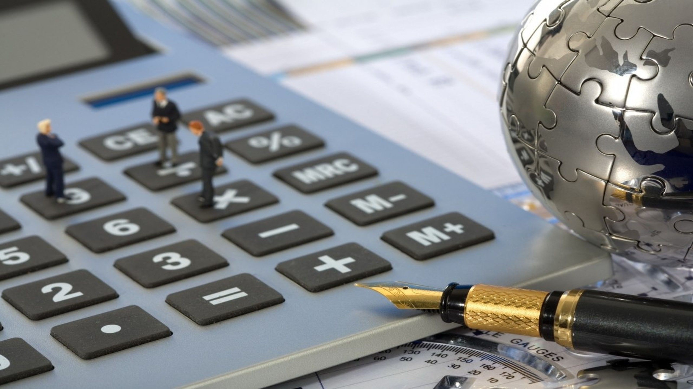

# What not to do if your income suddenly increases?

When our income suddenly increases, it is a reason to rejoice. However, the wrong attitude towards a sudden increase in income can lead to a catastrophic shortage of funds after some time.

To avoid this, it is enough to observe a few rules.

1. Do not buy things impulsively, based on "mood" or just because you have enough money.

Buy only what was planned in a calm state. Then these things will continue to bring you joy with their practicality.

2. Try to gradually and responsibly get used to the "new money," living on the "old amount" for some time.

Divide the income into two parts: the amount you were receiving before the income increase, and the amount that has been added. Spend the old amount on necessary expenses such as transportation, food, utilities, and loan payments. As for the "addition," it is recommended to follow this plan:

- Put 50% into a high-yield bank deposit. This will allow you to accumulate a significant capital. According to experts' calculations, by investing just 150 rubles a day (the cost of a cup of coffee in a well-known coffee shop), you can have millions in a few years.

- Spend 20% on purchasing a new suit or phone to match your new position (or save it for the future).

- Allocate 10% to a charitable fund or financially assist those in need among acquaintances and relatives.

3. Do not show off your financial well-being. Do not strive to buy a multitude of "status" items. Functionally, they are no different from ordinary things, they just cost much more.

4. Do not take on new loans without paying off the previous ones. Even if you believe that you can afford any loan right now. However, this euphoria can be deceptive, and you may underestimate your financial capabilities.
