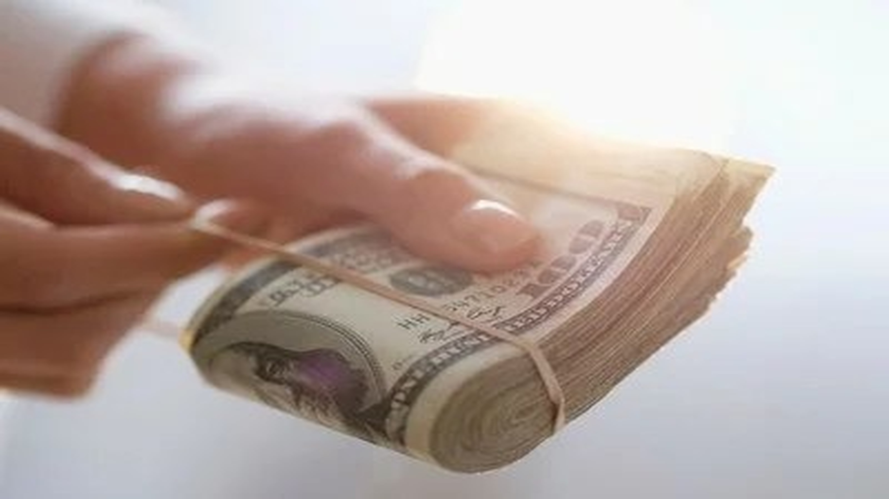

# 7 Common Misconceptions About Money

1. The first misconception is that big money can only be earned through hard work. If you think this way, you will spend your whole life working hard and earning a small salary. This thinking blocks your ability to earn big money. In reality, earning big money is very easy - you just need to accept this idea and use your intellect to earn them!

2. The second misconception is that money is not the most important thing in life. This statement hinders you from attracting money into your life, and with it, happiness! Money is an indicator of your value to the universe. If you don't have money, it means you are worth nothing. Believe me, money has immense value! With their help, you can afford all the pleasures that life can offer and bring happiness to your loved ones.

3. The third misconception is that money makes people bad. If you think that way, you are completely wrong. All millionaires and billionaires are intelligent and successful individuals. They are much kinder and fairer than the poor or alcoholics.

4. The fourth misconception is that you can't earn money by honest means. In reality, huge fortunes are made this way. Being useful and helping people always leads to earning big money.

5. The fifth misconception about money is that it's shameful to be rich when there are so many poor people around. In reality, being rich is delightful! You can afford to travel, enjoy life, and take care of your loved ones. If most people around you are poor, it's their own fault. Everyone creates their own destiny.

6. The sixth misconception about money is that if you have money, you should save it for a "rainy" day. Why do that? In reality, money should be invested in business, and then they will bring even more money. A "rainy" day will never come!

7. And finally, the most common and disgusting misconception - born poor, die poor - you can't change your destiny! This is a great way to shift responsibility for your life onto external circumstances. This is how those who don't want to do anything reason. In reality, most of the world-renowned billionaires come from poor families.
