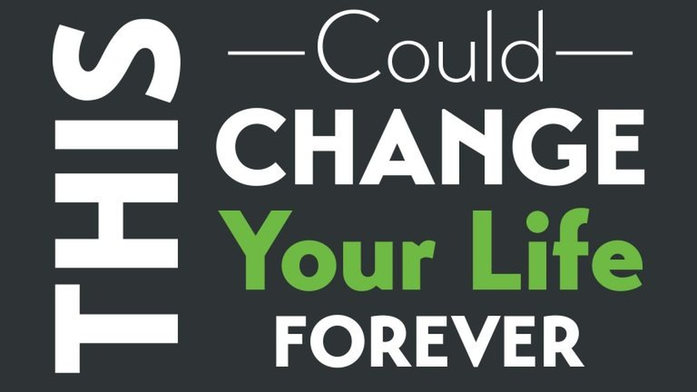

# How to change your life in a week

Sometimes it seems that a series of life difficulties and troubles go on continuously. It is possible to change the situation.

Now we will make a list of rules which we will follow for 7 days.

**1. By changing the usual train of thought**

Reducing the use of overused clichés, you will change your perception of the reality surrounding you. It will take a long time before changes come into your life, but as the wise man said, "taking a step overcomes the road."

**2. Believe, there is a place for gratitude in life**

Everything that seems familiar and ordinary to you also matters. Be grateful for what has happened and what has not, for what lies ahead. And be grateful even for what is not in your life.

**3. Create a list of things you want to achieve in life**

Always wanted to have a dog - get a puppy, take care of it. The world will become richer. There will be two more happy beings in it.

**4. Let every morning be happy**

The word "happiness". NOW, that is, here it is, the PRESENT. Remember this.

**5. Can only great tenors sing?**

Can't draw? Don't listen to anyone. Try, find yourself.

**6. What is the purpose of life?**

What do you want to achieve? To understand this, try to be sincere. What makes you happier, more joyful? What brings you pleasure?

**7. Changes occur every day**

And even if you don't always notice it. You have started a journey towards your truth and reality. And this is the best gift you could give yourself.
