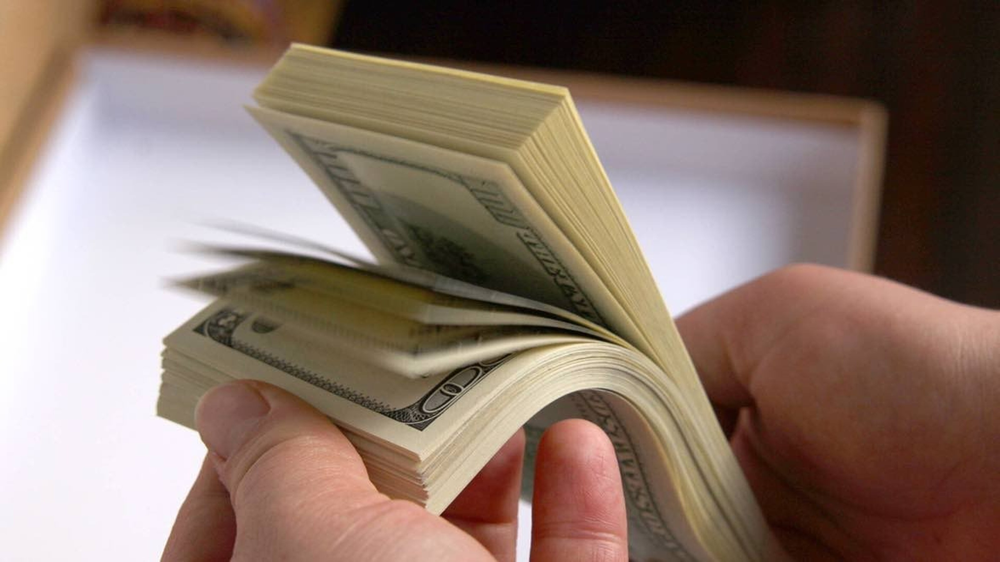

# 10 tips on how to always have money

**1. Be uncomfortable.**

The more convenient you are, the more you are used (without your benefit). So you go out for beer ten times, talk to your neighbors, wash the floor and set up your computer. Other's. Don’t think that your “good” deed will be remembered for what it deserves. Once, twice, and you will be bent over every time. And at this time you will waste time on new opportunities.

**2. Promise a lot.**

Even if you can’t handle it, you can always find someone who will do it for half the amount paid to you. Now my threshold is 30%. We need to strive for 10%.

**3. Control the situation.**

Never make excuses for circumstances. Be responsible for your actions. People appreciate this and trust you much more, feeling that you are a reliable person.

**4. Look for contacts.**

Meet new people every day. On the street, at exhibitions, at work, on the Internet. Give everyone your business card. It happens that it can work even after 5-10 years.

**5. Use your contacts.**

Introduce your friends. Showing how and where they can be useful to each other.

**6. Learn new things about your topic.**

Excludes public news. If something really important happens, you will know about it.

**7. Raise the price.**

Don't feel sorry for your customers - raise the price. If the product is exclusive, raise it three times. By the way, in the business in which I did this, sales also increased almost threefold. Those. profitability increased by 9. Since no additional marketing moves were undertaken.

**8. Use stereotypical thinking.**

People have stereotypes that inspire confidence in them. For example, one page with contacts and description attracts more leads (since it looks like a personal ad), but sells poorly. A multi-page online store with a good engine sells much better. Although it is also done in 20 minutes. A man in a good suit sells better than a man in a sports suit. Look for stereotypes of your target audience.

**9. Give little surprises.**

Send greeting cards to people you are interested in. When they need the services you provide, they will definitely remember you (and completely forget about your competitors).

**10. Always ask twice as much.**

They will give it and this happens in 6 cases out of 10. In case of emergency. After all, you can make a discount like 20%.
