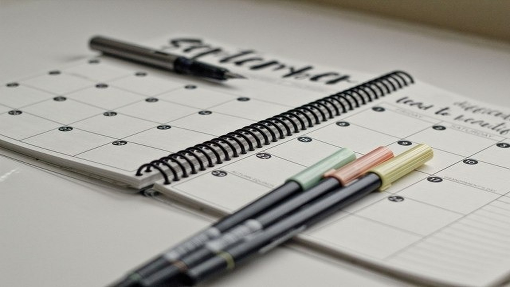

# 12 important rules that will make your life easier

**1. Keep your promises.**

Make it a habit to always keep your promises. If you promised to call back, call back! They promised to do something - do it! Do not spoil your reputation with unfulfilled promises and remember this rule forever!

**2. Are you late? Be warned about this!**

It’s also an important healthy habit that you shouldn’t forget about. Always warn when you are late or something else is out of your control.

**3. Never laugh at other people's dreams!**

This destroys a person and his attitude towards you! Don’t destroy other people’s dreams, think about it before you say anything, put yourself in his place, because when your dreams are ridiculed, it’s very unpleasant.

In one word you can kill!

**4. Do not return to those who betrayed you.**

As a rule, if a person betrayed you once, then it will not be difficult for him to do it a second time, and most likely he will do it. Betrayal leaves a deep wound, would you like to get it again?

**5. Spend more time with your parents.**

Spend as much time as possible with your parents - the moment when they are gone always comes unexpectedly. Don't forget about them, they will always be glad to see you, and when they are gone, you will regret that you were always busy for them.

**6. Be polite.**

As they say, politeness conquers cities, so never forget to be polite to everyone, use it as often as possible.

**7. Admit your mistakes.**

Many people do not know how to admit their mistakes. They always blame others for everything. Parents that they were sent to the wrong university, the government that it doesn’t have enough money, millionaires that they are millionaires, etc. Learn to take the blame on yourself, this is a very useful skill.

**8. Stop whining!**

Do you yourself like people who, from the very beginning of the conversation, start talking about their problems, how bad everything is, etc.? Personally, I don’t like them and I wouldn’t want to be like that, so give up the habit of whining, think positively, then the world will become a better place in your eyes.

**9. Don’t touch someone’s nerves.**

Even in a serious quarrel, never try to insult a person, because most likely you will make peace, and the words spoken will be remembered for a long time. And again I repeat - words can kill!

**10. Tell the truth.**

Always tell the truth, there are many advantages to this. For example, by telling only the truth, you will need to be able to remember and you will avoid many quarrels.

**11. Do the hardest thing at the beginning of the day.**

When you do it, the rest of the day you will not be overwhelmed by unnecessary, negative thoughts that can ruin your day. Also, after a difficult task, work becomes easier.

**12. Nobody owes anyone anything!**

Forget forever the word must, otherwise you will definitely become mired in material and moral debts to someone. You live your life and you don’t owe anyone anything, just like other people.
