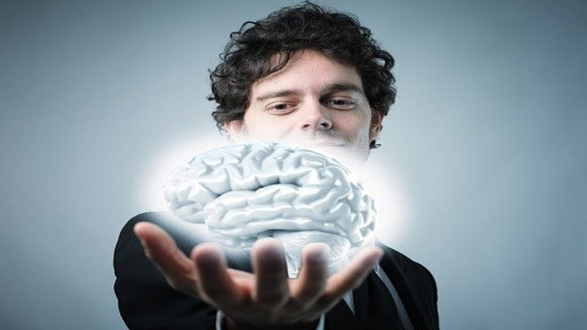

# 8 games our brain plays

**1. I would be happier if I had to work less.**

Our mind often resorts to this argument, claiming that we would be happier if we didn't have to work. We imagine a life full of entertainment and are deceived into thinking that this would make us happier. However, idleness is often the main cause of boredom and depression. We are hardworking, creative creatures. We must solve problems and improve ourselves in order to be happy. Invest your soul in something meaningful to yourself, and you will see how your level of happiness has risen!

**2. It's not me, it's all of them.**

Our mind tries to make us believe that the cause of our unhappiness is in other people: acquaintances, spouses, parents... We are ready to throw accusations left and right, like a child throws toys in kindergarten. Of course, it takes two to tango - as we blame others, they blame us. The moment when we take responsibility for our lives will serve as the foundation of true happiness.

**3. In order to be happy, I need to discover the secret of happiness.**

The secret is that there are no secrets to happiness or success. No matter how much books, authors and our own minds convince us, there are no secret keys to the door of Simple Human Happiness. You yourself create a picture of your future, formulate a strategy and then persistently and diligently work to implement it. There are no shortcuts here. Accepting this fact will take you much further along the path of happiness.

**4. If I had...**

Our brain tries to convince us that we would be happier if we had a different job, a different house, a different car... There is nothing wrong with wanting better things and circumstances, but this does not make us automatically happy. They can temporarily lift your spirits, but this all passes quickly. Anyone who wants lasting happiness must realize that the barrel of desires is bottomless and can never be filled to the top. And true happiness comes from within...

**5. I love what is and don’t want changes.**

By allowing ourselves to think this way, we create all the prerequisites for falling down. Life is a journey of constant change. Some of them we control, some we don’t. Resistance to change or an attempt to take control of everything is doomed to failure. Change is inevitable. You must accept this and learn to swim in the continuous flow of change. Adaptability is very important for happiness.

**6. If not today, then never.**

Our mind often falls into despair and succumbs to disappointment a few steps away from success. Perseverance is very important to achieve happiness. Never allow your mind to deceive you and accept defeat. You don't know what tomorrow will bring you. Just one day may be all it takes to achieve your dreams.

**7. I will make a decision when I know exactly what to do.**

The more you think, the sooner you reach a dead end. Weighing risks, analyzing opportunities and adopting a plan are important factors, but nothing happens until there is a decision and action. We very rarely have complete information to make decisions. Stop doubts! Failure is not the end of the world. Don't let your mind lead you into the trap of total analysis of everything in the world.

**8. I know I shouldn’t, but...**

Our mind tries to deceive us by denying the consequences of our bad habits. This is especially true for health issues. “I know I shouldn’t smoke, but it helps me lose weight.” Or: “I know I shouldn’t eat this, but if I can’t enjoy life, then why live at all.” Health problems are certainly a challenge to happiness. Don't let your mind catch you in the trap of self-justification and indulgence in your weaknesses. ‍ ‍‍
