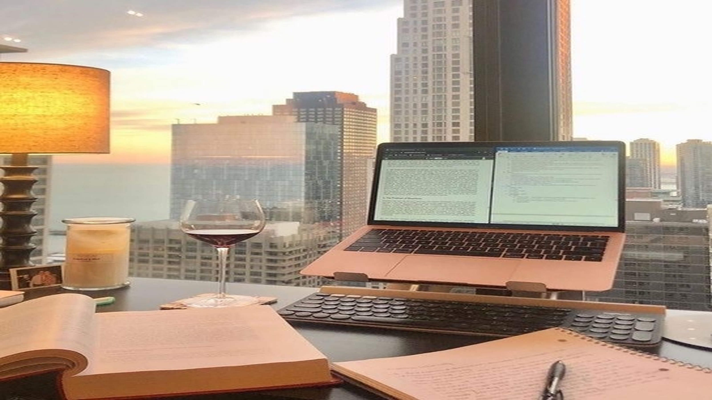

# Do a lot of things and not feel tired? It's quite possible!

**1. Get into the habit of planning the week's activities. **

One person, the head of a large company, shared: "When I started writing plans, I caught myself thinking that I stopped worrying about work. Everything is written down on paper, I won't forget anything - why bother?". The easiest way to plan: on Monday before you start work, write down all the things you need to do for the week, and then divide them by day. A new thing came up - put it on your list right away and think about when you'll get it done.

**2. Try to combine your to-do's so that you have more time. **

For example, if you need to do several field trips - combine them in one day, then the rest of the time you will be able to work in the office.

**3. Make a picture of the day.**

A plan will only work if you, at least in your imagination, make sure it is realistic. Imagine the moment you arrive at work, what you will do first, what you will do later, will you have enough time to accomplish everything you have planned? If you feel that you have more things to do than time - reconsider your schedule. The plan should be realistic.

**4. Plan for regular rests. **

Several short rests are better than one long rest. Apart from weekends, give yourself small rests during the day: lunch breaks, walks to the subway, short ten-minute breaks every hour at work. The alternation of things to do is also a kind of rest. Print an article, negotiate, go to the post office for a package. We have done three things, but there is no fatigue, because the cases are all different: while writing an article - worked head, when talking to a client - connected emotions, when we went to the post office - worked body.

**5. Do sports. **

Sports activities are not an additional waste of time. It is a vacation, a way to unwind, lift your spirits and gain vigor for the next day. Dancing, martial arts, fitness, exercise in the morning will be a great addition to your schedule.

**6. Work with music.**

Almost all regular work does not require extreme concentration and then you can work with music. Oddly enough, you get tired a lot less.

**7. Write long-term plans. **

The more areas of work, the more long-term plans should be. This will help to avoid overtime.
