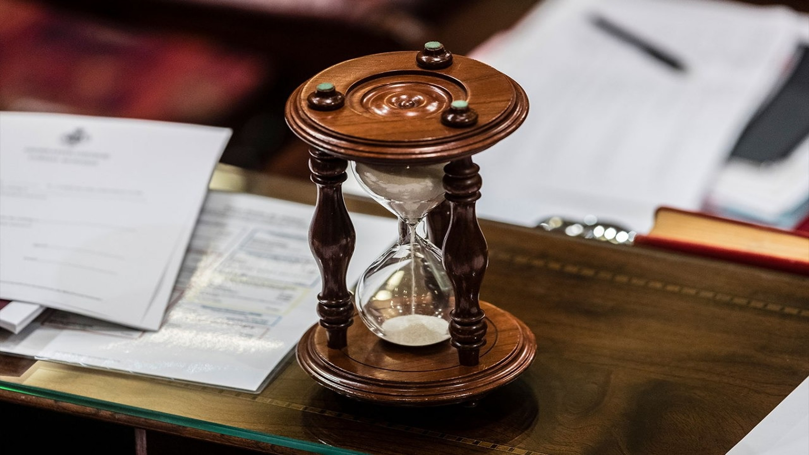

# Stop doing this right now

**1. Sit still.**

You can’t make money by sitting on the couch; you need to start working or studying.

**2. Live in the past.**

It happened and happened, the past cannot be changed. But we are quite capable of correcting the consequences.

So don't live in the past.

**3. Be afraid of change.**

Any change is for the better. Gain experience/benefits for yourself and move on towards your goal.
