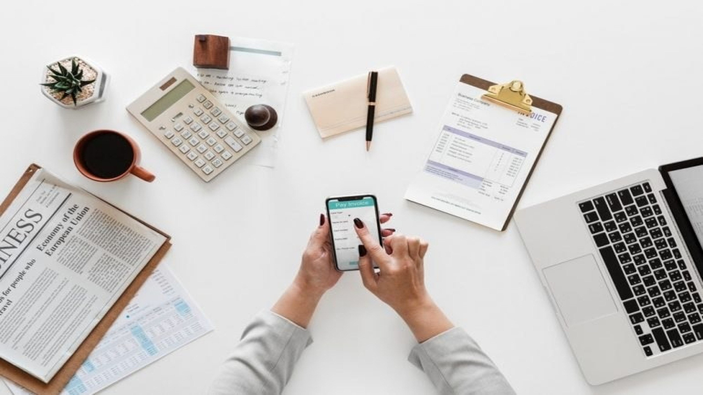

# 8 rules to get more done

1. Choose. Doing everything, doing everything, reading everything is a strategy from the last century. The world today is multi-layered and ambiguous - you need to choose, otherwise there is no other way.

2. Less control. Control is associated with an inflated sense of personal abilities and privileges, as well as with the inability to refuse and the desire to be good to everyone. This mission is impossible.

3. Manage your body pressure. That is, the need to respond to a message or close a notification as soon as possible. Doing small tasks gives you cheap dopamine. Don't become dependent on it.

4. Protect your concentration. When someone or something distracts you, the effect of imaginary importance occurs. But this comes at a huge cost, as it takes up to 23 minutes for the brain to regain focus and get back into flow.

5. Use tricks. Hemingway and Victor Hugo worked naked so that they would not be able to let anyone into their office or go out somewhere themselves. The artist who created the illustrations for "Tom Sawyer" covered his glasses with paper so that he would not be distracted by his peripheral vision.

6. Don't bring work home. Taking work home and always being in touch with everyone is a habit that only strokes your ego, but really interferes with real efficiency. Take care of your personal space and do not neglect rest.

7. Less fuss. By completing one task at a time, you will be less likely to experience procrastination. Remember that vanity cannot be controlled by vanity.

8. Don't confuse multitasking with multiprojecting. All people manage a large number of projects - family relationships, leisure time, diet, several work projects... And this is normal. The main thing is not to try to do everything at the same time.
